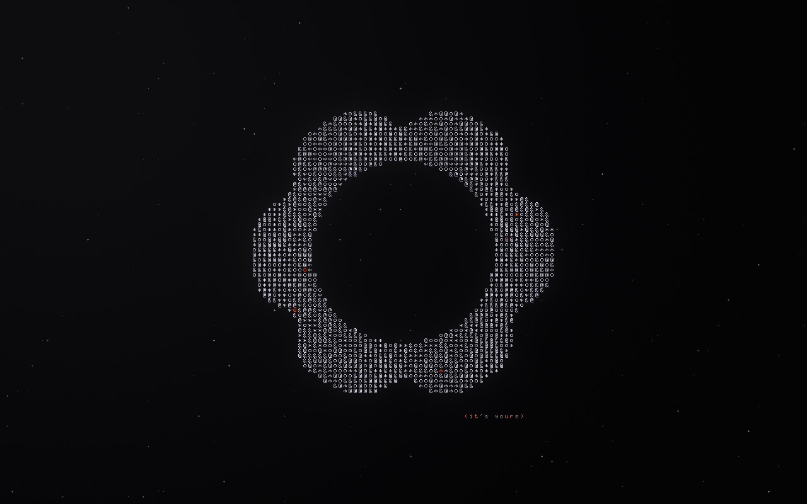

# Framework ASCII shader wallpaper

[Live demo](https://sylvesterroos.github.io/framework-shader-wallpaper/)

## Usage

`framework_ascii.glsl` is a single Shadertoy-style fragment shader: `mainImage(out vec4, in vec2)` reading `iResolution` and `iTime`. It scales with the render height, so any resolution and aspect ratio works. The reference render is 2880×1920.

- **Shadertoy:** paste the file into the Image tab.
- **KDE Plasma:** load it with a shader wallpaper plugin such as [ShaderWallpaper](https://github.com/y4my4my4m/kde-shader-wallpaper).
- **Browser:** serve this directory and open `index.html`.

Set `tagline` at the top of the shader to `0.0` to hide the caption.
